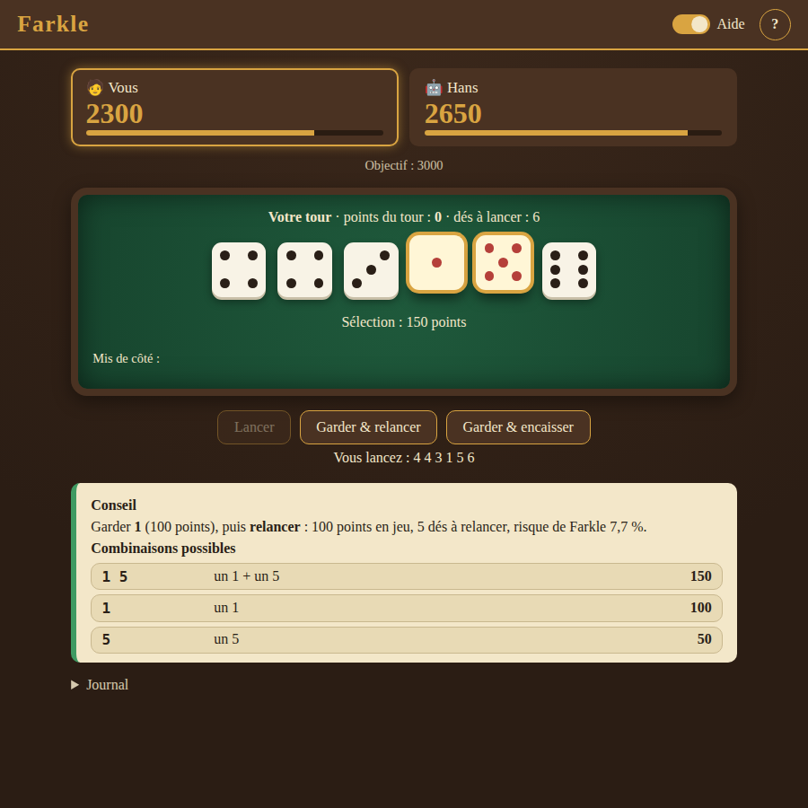
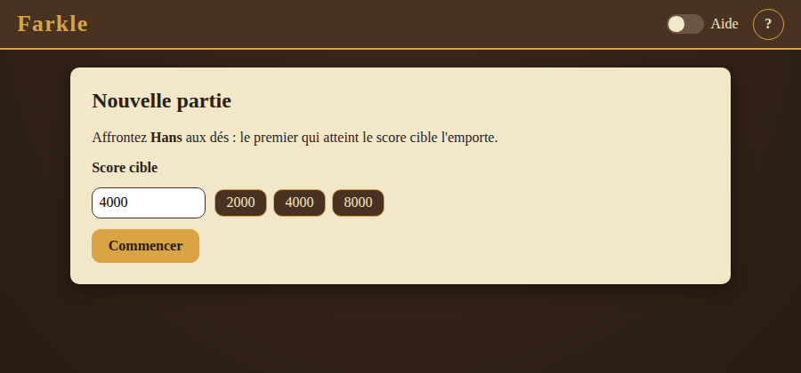
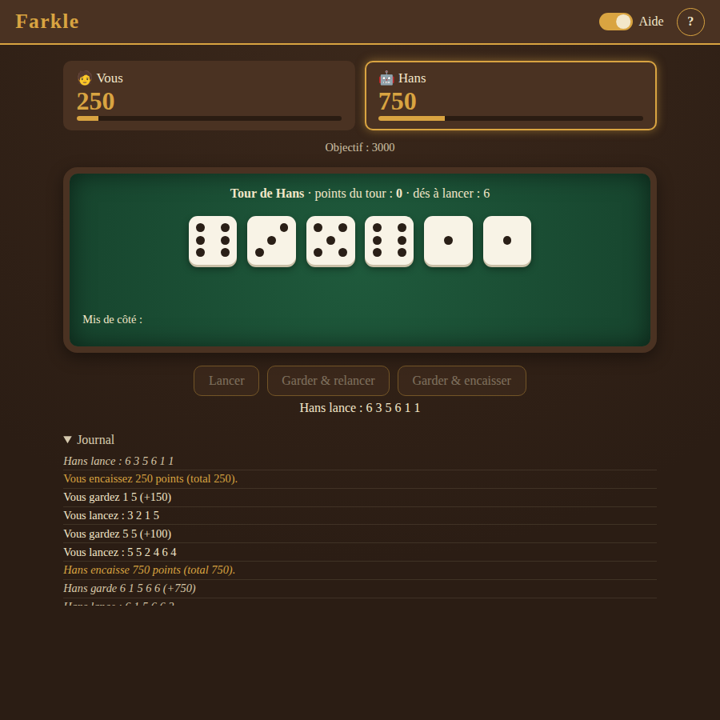
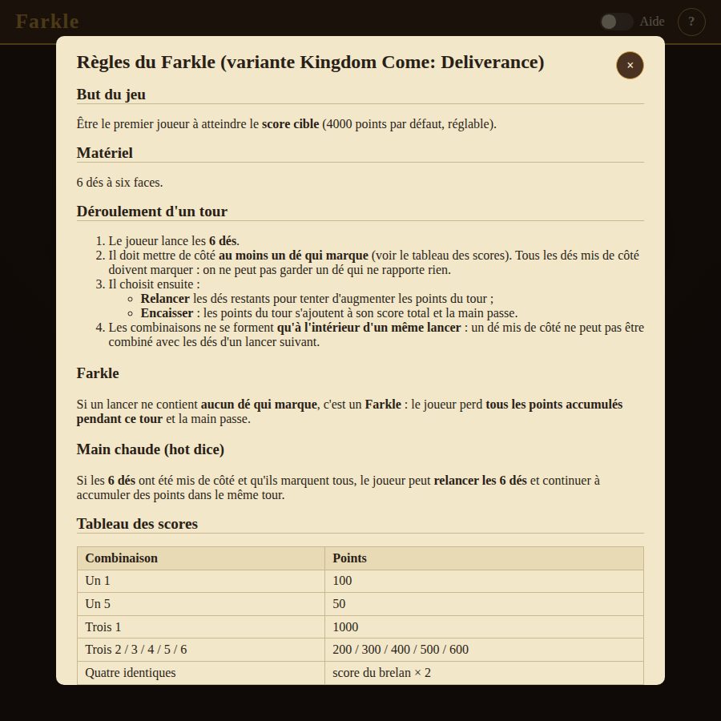
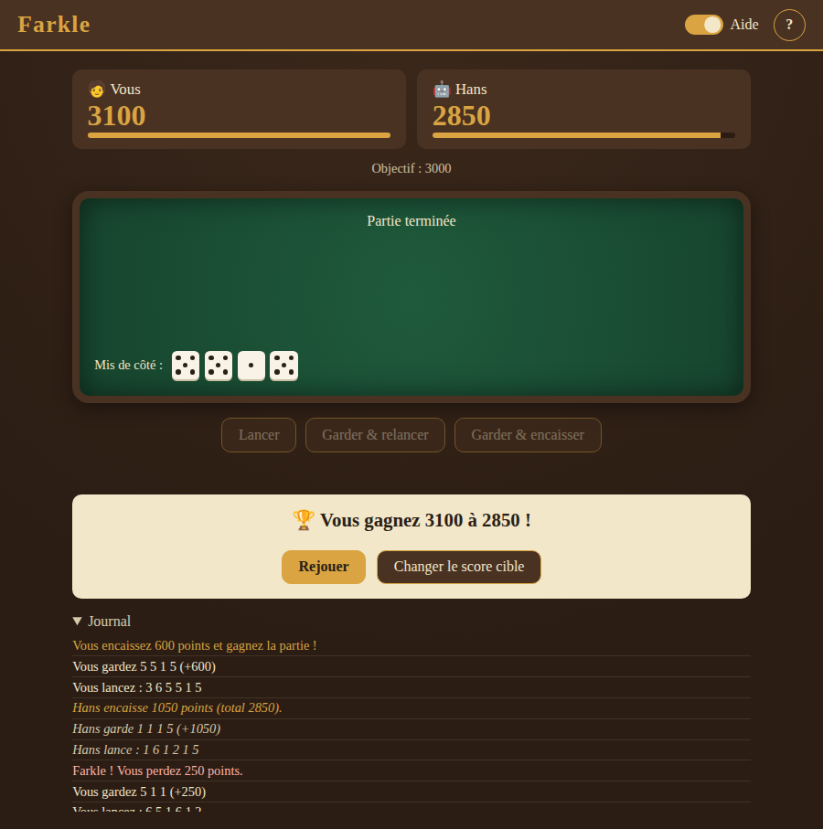
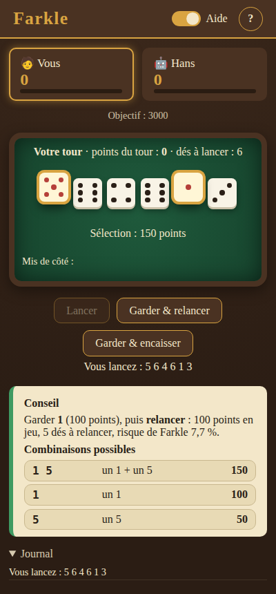

# Farkle 1.0

Jeu de dés **Farkle**, avec les règles de *Kingdom Come: Deliverance*, écrit en Rust.
On y affronte Hans, une IA, dans le navigateur (Rust compilé en WebAssembly) ou en console.
Un **mode entraîner** conseille sur vos propres lancers.

**▶ Jouer en ligne : <https://mraugir.github.io/farkle1_0/>**



## Sommaire
- [Règles en bref](#règles-en-bref)
- [Jouer dans le navigateur](#jouer-dans-le-navigateur)
- [Jouer en console](#jouer-en-console)
- [Mode entraîner](#mode-entraîner)
- [Architecture](#architecture)
- [Développement](#développement)

## Règles en bref
On joue avec 6 dés. À chaque lancer, on met de côté au moins un dé qui marque, puis on choisit :
**relancer** les dés restants ou **encaisser** les points du tour. Un lancer sans aucun dé qui marque
est un **Farkle** : on perd les points du tour. Si les 6 dés ont marqué (**main chaude**), on peut
relancer les 6. Le premier joueur qui atteint le score cible (4000 par défaut) gagne.

| Combinaison | Points |
|---|---|
| Un 1 / un 5 | 100 / 50 |
| Trois 1 | 1000 |
| Trois 2 à trois 6 | 200 à 600 |
| Chaque dé identique en plus | × 2 (six 1 = 8000) |
| Suites 1-5 / 2-6 / 1-6 | 500 / 750 / 1500 |

Règles complètes, avec des exemples : [docs/REGLES.md](docs/REGLES.md). Elles sont aussi affichées
par `farkle --help` et par le bouton **?** du navigateur.

## Jouer dans le navigateur
En ligne : <https://mraugir.github.io/farkle1_0/>. Pour jouer en local :
```bash
rustup target add wasm32-unknown-unknown
cargo install wasm-pack --locked          # avec rustc 1.90 : ajouter --version 0.13.1
wasm-pack build crates/farkle-web --target web --out-dir ../../web/pkg
python3 -m http.server -d web 8000        # puis ouvrir http://localhost:8000
```

1. Choisissez le score cible, puis cliquez sur **Lancer**.
2. Cliquez sur les dés à garder. Le score de la sélection s'affiche en direct.
3. Cliquez sur **Garder & relancer** ou sur **Garder & encaisser**. Hans joue ensuite son tour pas à pas.

L'interrupteur **Aide** surligne les dés qui marquent. Il affiche aussi le conseil (que garder,
s'il vaut mieux relancer ou encaisser, et le risque de Farkle) et la liste des combinaisons :
un clic sur une combinaison sélectionne les dés correspondants.

| Configuration | Tour de l'IA |
|---|---|
|  |  |
| **Règles (bouton ?)** | **Fin de partie** |
|  |  |

<p align="center"></p>

## Jouer en console
```bash
cargo run -p farkle-cli -- --help                          # usage et règles complètes
cargo run -p farkle-cli -- play --target 2000 --aide on    # partie contre l'IA, avec l'aide
cargo run -p farkle-cli -- play --ia audacieuse            # IA prudente, normale ou audacieuse
cargo run -p farkle-cli -- rules                           # règles seules
```
En jeu, tapez :
- les numéros des dés à garder (`1 3 5` ou `135`) ;
- `r` pour relancer, `b` pour encaisser, `s` pour suivre le conseil ;
- `a` pour activer ou désactiver l'aide, `?` pour afficher les règles, `q` pour quitter.

## Mode entraîner
Vous jouez avec de vrais dés (ou dans *Kingdom Come*) : saisissez vos lancers, et le programme vous conseille.
```bash
cargo run -p farkle-cli -- train                            # objectif 4000, score 0
cargo run -p farkle-cli -- train --target 4000 --score 3500 # s'entraîner sur une fin de partie
```
```text
Lancer (6 dés) : [1] [1] [1] [5] [2] [3]
Combinaisons possibles :
  - 1 1 1 5 → 1050 pts (trois 1 + un 5)
  - 1 1 1 → 1000 pts (trois 1)
  - 1 1 5 → 250 pts (deux 1 + un 5)
  ...
Conseil : garder 1 1 1 5 (dés n°1 2 3 4) → 1050 pts au tour, puis encaisser
Dés gardés (numéros, s = conseil) : +1050 pts — 1050 pts au tour, 2 dés à relancer.
Conseil : encaisser (risque de Farkle 44.4 % si vous relancez 2 dés)
Espérance si vous relancez : 633 pts (contre 1050 pts en encaissant).
```
Indiquez les dés réellement gardés, puis `r` (je relance) ou `b` (j'encaisse). Le score total est suivi.

## Architecture
```
crates/
├── farkle-core/   moteur pur, sans I/O : dés, scoring, combinaisons, partie, conseiller, IA
├── farkle-cli/    binaire `farkle` (clap) : play, train, rules
└── farkle-web/    façade wasm-bindgen : WebGame, combos, rules_markdown
web/               index.html, style.css, main.js, markdown.js, format.js (+ pkg/ généré)
docs/              REGLES.md (source unique des règles), PLAN.md, RECETTE-WEB.md
```
- **Le hasard est injectable** grâce au trait `DiceRoller` : `RandomRoller` (SplitMix64 avec graine,
  sans dépendance) ou `ScriptedRoller` (pour les tests).
- **Le conseiller** compare l'espérance d'une relance aux points en jeu. Il s'appuie sur la probabilité
  exacte de Farkle et sur le meilleur score espéré pour 1 à 6 dés, calculés en énumérant les 6ⁿ lancers.
  L'aide, l'IA et le mode entraîner partagent ce même conseiller.
- **API JavaScript** (`farkle-web`) :
  - `new WebGame(target, seed)` crée une partie ;
  - `roll()`, `select([indices])`, `reroll()`, `bank()` et `ai_turn_step()` renvoient l'état de la
    partie en JSON, ou lèvent une exception avec un message en français ;
  - `state()` renvoie la phase, les scores, les dés, les combinaisons, le conseil (`advice`,
    `recommendation`) et le dernier événement (`last_event`) ;
  - `combos([dés])` et `rules_markdown()` complètent l'API.

## Développement
```bash
git config core.hooksPath .githooks       # active le hook pre-push (fmt, clippy, tests Rust et JS)
cargo test --workspace                    # tests Rust
wasm-pack test --node crates/farkle-web   # tests dans un moteur WebAssembly
node --test 'web/tests/*.test.mjs'        # rendu markdown et textes de l'interface
```
- **Workflow** : une branche `lot-N/<nom>` par lot, créée depuis `develop`, en TDD (un commit de tests
  rouges, puis l'implémentation), puis un merge `--no-ff` dans `develop`. Plan des lots :
  [docs/PLAN.md](docs/PLAN.md).
- **CI** (`.github/workflows/ci.yml`) : fmt, clippy, tests, build et tests WASM, et tests JS, à chaque
  push et à chaque PR.
- **Déploiement** (`.github/workflows/pages.yml`) : à chaque push sur `main`, le paquet WASM est construit
  et `web/` est publié sur GitHub Pages. Il faut une fois pour toutes choisir, dans *Settings → Pages*,
  la source *GitHub Actions*.
- **Recette manuelle** de l'interface : [docs/RECETTE-WEB.md](docs/RECETTE-WEB.md).
